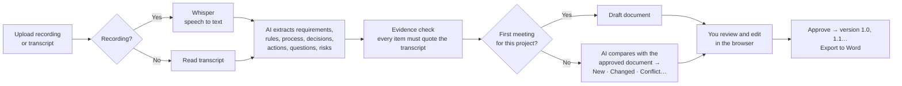

# ReqDoc AI — Requirement Documents from Meeting Recordings

> **Phase 1 prototype.** A local website where you upload a meeting **recording** (or a Teams transcript). The AI turns it into a structured requirement document you can edit in the browser and **export to Word**. Upload the next meeting for the same project and the document is **updated**, with every change shown to you for approval.

Everything runs on your own laptop: the website, the speech-to-text (Whisper) and the AI model (Ollama). No cloud services, no API keys, and no meeting data leaves your machine.

---

## Contents

1. [Why this exists](#1-why-this-exists)
2. [What Phase 1 does (and doesn't)](#2-what-phase-1-does-and-doesnt)
3. [How it works](#3-how-it-works)
4. [Prerequisites](#4-prerequisites)
5. [Quick start](#5-quick-start)
6. [Using the website](#6-using-the-website)
7. [Exporting to Word](#7-exporting-to-word)
8. [The requirement document](#8-the-requirement-document)
9. [Follow-up meetings and change types](#9-follow-up-meetings-and-change-types)
10. [Configuration](#10-configuration)
11. [Project structure](#11-project-structure)
12. [For developers](#12-for-developers)
13. [Claude Code skills](#13-claude-code-skills)
14. [Tips for good output](#14-tips-for-good-output)
15. [Safeguards and limitations](#15-safeguards-and-limitations)
16. [Roadmap](#16-roadmap)
17. [Troubleshooting](#17-troubleshooting)

---

## 1. Why this exists

Writing a proper requirement document after a meeting takes 1 to 2 hours, so it's usually the first task dropped. When people leave, the reasons behind decisions leave with them. ReqDoc AI turns that writing into **about 10 minutes of review**: upload the recording, check the draft, fix what's wrong, approve, and export to Word.

The full vision (Teams auto-pickup, SharePoint filing, AWS Bedrock) is in `Proposal AI-Generated Requirement Docs from Meetings.docx`. Phase 1 tests the **core value**: is the AI's document good enough to approve with light edits?

## 2. What Phase 1 does (and doesn't)

| Does | Doesn't (yet) |
|---|---|
| Upload a **recording** (MP3, M4A, WAV, MP4, WEBM…) and transcribe it locally | Pick up Teams recordings automatically |
| Upload a Teams transcript (`.vtt`, `.docx`) or plain text (`.txt`) | Tell speakers apart in a recording (see [limitations](#15-safeguards-and-limitations)) |
| Write an 18-section requirement document | Save to SharePoint or send Teams approval cards |
| **Edit everything in the browser**: text, owner, priority, status | Use cloud AI (Bedrock / Claude). That's Phase 2 |
| **Export to Word (.docx)** for any approved version or the current draft | Handle several people editing one project at the same time |
| On follow-up meetings: show New / Changed / Conflict … for you to accept or reject | |
| Keep version history (v1.0, v1.1 …) and a change log | |

## 3. How it works



Key design choices:

- **The requirement register is the source of truth.** The Word document is regenerated from it every time, so edits you make in the website always flow into the next meeting's comparison.
- **Five focused AI passes** (requirements, process, decisions, actions, questions and risks) instead of one big prompt. This is what lets a small local model catch nearly everything. See [Developers](#12-for-developers).
- **Python assigns IDs, not the AI.** FR-014 is always the next number; existing IDs never change.
- **Nothing is applied without a person.** Conflicts are never resolved by the AI.
- **Recordings are deleted after transcription.** Only the text is kept.
- **The AI model is swappable.** All model calls go through one `LLMClient` interface, so moving to AWS Bedrock in Phase 2 means adding one class.

## 4. Prerequisites

| Item | Version | Notes |
|---|---|---|
| Windows 10/11 | — | |
| Python | 3.11 or newer | [python.org](https://www.python.org/downloads/). Tick **"Add python.exe to PATH"** |
| Ollama | latest | [ollama.com/download](https://ollama.com/download). Runs the AI model locally |
| Node.js LTS | 20 or newer | **Only needed once to build the website** (`setup.ps1` does it). Not needed to run it. Developers need it for front-end work |
| Disk | ~8 GB free | AI model (~5 GB), speech model (~0.5 GB), packages |
| Internet | first setup only | To download the models |

### Which AI model for your laptop?

| Your laptop | `OLLAMA_MODEL` | Speed |
|---|---|---|
| 16 GB RAM, no GPU (typical office laptop) | `qwen2.5:7b` **(default)** | A 10 minute meeting takes ~5 minutes; a 1 hour meeting 15 to 30+ minutes |
| 32 GB RAM, or NVIDIA GPU with 8 GB+ VRAM | `qwen2.5:14b` (better quality) | Faster on GPU |
| Less than 16 GB RAM | `qwen2.5:3b` | Fast but noticeably weaker. Trying the app only |

Speech-to-text (`WHISPER_MODEL`, default `small`) is much faster than the AI step: a 41 second clip took about 8 seconds on a laptop CPU.

## 5. Quick start

```powershell
# 1. Get the code (or copy the folder from the shared drive)
cd "AI-Requirement Gathering Doc"

# 2. One-time setup: Python packages, AI model, speech model, builds the website
powershell -ExecutionPolicy Bypass -File .\setup.ps1

# 3. Start the app (every time). The browser opens automatically.
powershell -ExecutionPolicy Bypass -File .\run.ps1
```

Then use **http://localhost:8000**. Press `Ctrl+C` in the window to stop.

`setup.ps1` needs Node.js only to build the website the first time. If a teammate already has a built `frontend\dist` folder, copy it in and Node.js isn't needed at all.

## 6. Using the website

### 6.1 First meeting on a project

1. **Projects** page → **New project** → enter a code and name, e.g. `PRJ-0421` / `Site Diary App`.
2. Open the project → **Upload meeting** → drop the **recording** (or transcript) → give it a title and date → **Start**.
3. A progress bar shows the steps (transcribing → finding requirements). It takes a few minutes. You can leave the page open or come back later.
4. When it finishes you get a **draft**. Review the **Requirements** tab:
   - Click any cell to fix the wording, owner, due date, priority or status.
   - Click a time like `[00:23:14]` to open the transcript at the exact place the item came from.
   - Items marked **⚠ to confirm** could not be matched to the transcript. Check them, then click the tag to clear it.
   - **Add** rows for anything the AI missed.
5. Click **Save edits**, then **Approve**, enter your name, and it becomes **v1.0**.

> Rows you've saved are never deleted. To drop an item, set its **Status** to *Withdrawn*. This keeps the history honest.

### 6.2 Follow-up meetings

Upload the next recording to the **same project**. Instead of a new document you get a **Changes to review** tab (for example *"7 changes: 3 new, 2 changed, 1 conflict, 1 question answered"*).

- **Accept** or **Reject** each change. Accepted changes are applied to the draft immediately.
- **Conflicts** show the existing wording next to the new wording. Choose **Keep existing** or **Use new wording**. The AI never decides.
- **Accept all except conflicts** is a quick way through the easy ones.
- When nothing is left undecided, review the **Requirements** tab, then **Approve**. The version becomes v1.1 (or switch on *Major revision* for v2.0).

Only **one draft per project** can be open at a time. Approve or discard it before uploading the next meeting.

### 6.3 Getting a transcript from Teams (optional)

A Teams transcript gives better results than a recording, because it knows who said what.

1. Make sure **Record and transcribe** was on during the meeting.
2. After the meeting, open the meeting chat → **Recap** → **Transcript**.
3. **Download** as **.vtt** or **.docx** and upload it instead of a recording.

### 6.4 Where files are saved

By default under `data/projects/<code> <name>/`. To share with the team, point `REQDOC_DATA_DIR` at a synced OneDrive/SharePoint folder (see [Configuration](#10-configuration)). Keep the path short: Windows stops working at 260 characters, and the app will tell you if you hit it.

## 7. Exporting to Word

The requirement document is exported as a **Word file (.docx)**:

- Click **Export Word** at the top of the project. The button's menu lets you choose the **current draft** or the **latest approved version**.
- Older versions: **Versions and meetings** tab → **Word** next to the version.
- File names look like `PRJ-0421_Site-Diary-App_v1.1.docx`. Drafts end with `_DRAFT`.
- The document has a header with the project, a footer with version, status and page number, and a red **DRAFT — AI-generated** banner until it is approved.
- The workflow diagram is included as diagram source (Mermaid). Paste it into [mermaid.live](https://mermaid.live) to get a picture. A drawn image inside Word is planned.
- To use a company look, put a Word file called `templates/requirement_template.docx` in the project. Its styles (fonts, headings, table style) are used for the export.

## 8. The requirement document

Every document follows one fixed template. Sections with nothing discussed say **"Not discussed in this meeting"**. They are never filled with invented content.

| # | Section | What goes in it |
|---|---|---|
| 1 | Document control | Project code, meeting title, date, attendees, version, status, reviewer |
| 2 | Meeting summary | 5 to 8 lines: purpose, outcome, key points |
| 3 | Business objectives | Why this is needed, problem being solved |
| 4 | Scope | In scope, out of scope, deferred |
| 5 | Stakeholders and users | Roles, users, approvers |
| 6 | Functional requirements | `FR-001`… with priority (Must/Should/Could), requested by, transcript time |
| 7 | Non-functional requirements | `NFR-001`… performance, security, access, offline, integration |
| 8 | Current process (as-is) | Steps and pain points |
| 9 | Proposed process (to-be) | Steps for the new way of working |
| 10 | Workflow diagram | Flowchart of the to-be process |
| 11 | Business rules | e.g. "Hot work permits cannot be longer than 8 hours" (`BR-001`…) |
| 12 | Data and fields | Forms, fields, reports mentioned |
| 13 | Assumptions and constraints | Budget, timeline, technical limits |
| 14 | Decisions made | What was agreed, by whom (`DEC-001`…) |
| 15 | Open questions | Unresolved points with owner (`Q-001`…) |
| 16 | Action items | Task, owner, due date (`ACT-001`…) |
| 17 | Risks | Risks raised (`RSK-001`…) |
| 18 | Glossary | Project and company terms |
| — | Appendix | Source meetings and the change log |

## 9. Follow-up meetings and change types

| Type | What happens when you accept | Example |
|---|---|---|
| **New** | Added with the next ID, status *Proposed* | "Supervisors also want photo upload" → FR-014 |
| **Changed** | Wording updated, ID kept, old wording recorded in the change log | Approval limit $50,000 → $30,000 |
| **Confirmed** | Status → *Agreed* | "Yes, offline mode is a must" |
| **Withdrawn** | Status → *Withdrawn*. **Never deleted** | "We no longer need Excel export" |
| **Conflict** | You choose: keep existing or use the new wording | Meeting 3 contradicts meeting 1 |
| **Answered** | Open question closed, answer recorded | "Who approves variations?" → PM |
| **Action done** | Earlier action ticked off | "Vendor sent the sample forms" |

Plain lists (objectives, scope, process steps, data fields, assumptions, glossary) only ever get **New** entries: anything not already there is offered to you.

## 10. Configuration

`setup.ps1` creates `.env` from `.env.example`. Edit it as needed:

| Key | Default | Purpose |
|---|---|---|
| `REQDOC_PORT` | `8000` | Port of the website. Change it if another program uses 8000 |
| `OLLAMA_HOST` | `http://localhost:11434` | Where Ollama runs. Point at a teammate's GPU PC to share one model |
| `OLLAMA_MODEL` | `qwen2.5:7b` | AI model (see [model table](#which-ai-model-for-your-laptop)) |
| `OLLAMA_NUM_CTX` | `16384` | Context window in tokens. Lower it if you run out of memory |
| `OLLAMA_NUM_GPU` | *(unset)* | Set to `0` to force CPU-only. Needed if Ollama crashes with a CUDA error |
| `OLLAMA_MAX_TOKENS` | `4096` | Max length of one AI answer. Stops a looping model from running for minutes |
| `WHISPER_MODEL` | `small` | Speech model: `tiny`, `base`, `small`, `medium`. Bigger is more accurate and slower |
| `WHISPER_LANGUAGE` | `en` | Language spoken in recordings. Empty = auto-detect |
| `CHUNK_TOKENS` | `6000` | Transcript chunk size per AI call |
| `REQDOC_DATA_DIR` | `./data` | Where projects are stored. Can be a synced folder (keep the path short) |
| `GLOSSARY_FILE` | `./config/glossary.txt` | Company/construction terms given to the AI to improve accuracy |

## 11. Project structure

```
reqdoc/                        # Python backend
  api.py                       # FastAPI: /api/* and serves the built website
  jobs.py                      # Background worker: transcribe → extract → compare
  transcribe.py                # Recording → text (faster-whisper)
  parsers.py                   # .vtt / .docx / .txt → [{timestamp, speaker, text}]
  pipeline.py                  # chunk → extract (5 passes) → merge → evidence check → register
  changes.py                   # Follow-up comparison and applying accepted changes
  storage.py                   # Projects, drafts, versions on disk
  render.py                    # register → Markdown and Word (.docx)
  diagram.py                   # to-be steps → Mermaid flowchart
  llm.py                       # LLMClient interface + OllamaClient (Phase 2: BedrockClient)
  models.py, config.py
  prompts/                     # extract_*.md, diff.md, resolve.md, summary.md
frontend/                      # React + TypeScript + Ant Design + Tailwind, built with Rsbuild
  src/pages, src/components, src/api.ts
  dist/                        # built website (created by setup.ps1)
templates/requirement_template.docx   # optional company Word styles
config/glossary.txt
tests/                         # pytest, fixtures with expected answers
scripts/evaluate.py            # extraction quality score
docs/IMPLEMENTATION_PLAN.md    # design notes
.claude/skills/                # Claude Code skills
setup.ps1  run.ps1  dev.ps1  requirements.txt  .env.example
```

Project data on disk mirrors the proposal's SharePoint layout, so moving to SharePoint later is straightforward:

```
data/projects/PRJ-0421 Site Diary App/
  project.json
  01_meeting_docs/             # what each meeting said
  02_master/
    register.json              # current approved document
    versions/v1.0/             # register.json + master.docx per version
  03_transcripts/              # text of every meeting (recordings are deleted)
  _pending/                    # the one open draft and its change list
```

## 12. For developers

```powershell
.\dev.ps1                       # API with auto-reload + website with hot reload on http://localhost:3000
.\.venv\Scripts\python -m pytest # backend tests (no Ollama or Whisper needed; they are faked)
cd frontend; npm run typecheck; npm run build
.\.venv\Scripts\pip install -r requirements-dev.txt   # once: adds Playwright
.\.venv\Scripts\python tests\ui\run_ui_e2e.py          # clicks through the whole website in Edge (about 1 minute)
.\.venv\Scripts\python scripts\evaluate.py   # score extraction on tests/fixtures (needs Ollama, ~10 min)
```

- **Front end:** React 18, Ant Design 5, Tailwind 3 (preflight off so it doesn't fight Ant Design), Rsbuild. In development `/api` is proxied to the Python server.
- **Look and feel:** off-white paper, ink text, terracotta accent, Inter plus Cormorant Garamond italic (fonts are bundled, so it works offline). All colours and Ant Design settings live in `frontend/src/theme.ts` (mirrored in `tailwind.config.cjs`); shared classes (`.eyebrow`, `.display`, `.serif`, `.chip`) are in `src/index.css`.
- **UI test:** `tests/ui/run_ui_e2e.py` starts the real app with a scripted AI model and drives Edge through create project → upload → edit → export → approve → follow-up → versions, on desktop and a 390px phone. It fails on any console error, failed request or sideways scroll, and saves screenshots to `output/ui/`.
- **Why five AI passes:** with one big prompt, the 7B model found 28% of the expected items in our test meetings. Required JSON keys plus five focused passes, each with a worked example, raised that to 98%. The pass list is `PASSES` in `reqdoc/pipeline.py`.
- **Evidence check:** every extracted item must quote the transcript. If the words can't be found it is flagged **⚠ to confirm** instead of being dropped, because a wrong item is easy to delete but a missing one is invisible.
- Use the `reqdoc-dev` and `evaluate-extraction` Claude Code skills (below) before changing prompts or models.

## 13. Claude Code skills

The repo includes [Claude Code](https://docs.claude.com/en/docs/claude-code) skills in `.claude/skills/`. Open this folder in Claude Code and they're available automatically. Type `/` to see them, or ask in plain English.

| Skill | Use it when | Example |
|---|---|---|
| `generate-requirement-doc` | You want a requirement doc from a transcript without the app, or a high-quality **benchmark** to compare with the local model | *"Generate a requirement doc from tests/fixtures/sample_ptw.vtt"* |
| `update-master-requirements` | You want the change list for a new transcript against an existing `register.json` | *"Update PRJ-0421's master with this new transcript"* |
| `reqdoc-dev` | You're changing the code: layout, conventions, how to run and test | *"Add support for Zoom .txt transcripts"* |
| `evaluate-extraction` | Before changing a prompt or model: scores output against the test fixtures | *"Evaluate qwen2.5:14b against the fixtures"* |

## 14. Tips for good output

- **Say names out loud.** Recordings have no speaker labels, so owners come from what people say: *"Kumar, can you check the phones by 30 October?"* is captured perfectly; *"can you check that?"* is not.
- **Recap decisions at the end** of the meeting ("So we agreed…"). This is the single biggest quality boost.
- **Use a decent microphone** in site offices. Transcript quality limits document quality.
- **Add project terms** to `config/glossary.txt` (system names, site names, abbreviations).
- **Prefer the Teams transcript** over a recording when you have one: it has speaker names.
- **One project per meeting** where possible. Mixed meetings produce mixed documents.

## 15. Safeguards and limitations

**Safeguards**
- Every document is labelled **DRAFT / AI-generated** until a named reviewer approves it.
- Items without transcript evidence are flagged **⚠ to confirm**, not silently included.
- Nothing is ever deleted: withdrawn and changed items stay in the document and the change log.
- Every version is kept under `02_master/versions/`.
- Recordings are deleted right after they are transcribed.

**Limitations**
- **No speaker labels for recordings.** Whisper turns speech into text but doesn't know who spoke. The AI can only name people who are addressed or introduce themselves.
- Local models are smaller than cloud models. Expect more review edits than Phase 2 will need. Measuring that gap is part of what Phase 1 is for.
- Processing is slow on CPU-only laptops (see the [model table](#which-ai-model-for-your-laptop)).
- Accents, Singlish, site noise and crosstalk reduce transcript accuracy, which carries into the document.
- Meetings are processed one at a time.

**Consent (PDPA):** only process meetings where attendees were told the meeting is recorded and transcribed for requirement documentation. Don't upload HR, 1-to-1 or unrelated meetings. Everything stays on your machine or your chosen synced folder.

## 16. Roadmap

| Phase | Scope |
|---|---|
| **1 — Local prototype (this)** | Recording or transcript → document → editable → Word, with reviewed updates. Ollama + Whisper + React. Measure quality on 5+ real meetings |
| **2 — Company AI and storage** | Swap `OllamaClient` → `BedrockClient` (Claude Sonnet, ap-southeast-1). Save to SharePoint via Microsoft Graph. Speaker labels. Workflow diagram as an image in Word |
| **3 — Hands-free** | Teams transcript auto-pickup via Graph notifications, project code from meeting title, Teams approval cards (Power Automate) |

## 17. Troubleshooting

| Problem | Fix |
|---|---|
| Orange banner "The AI model is not ready" | Start Ollama from the Start menu (system tray), or run `ollama serve`. If the model is missing: `ollama pull qwen2.5:7b` |
| `CUDA error: shared object initialization failed` | Ollama's GPU runtime doesn't work with your GPU. Add `OLLAMA_NUM_GPU=0` to `.env` |
| `run.ps1` says the port is in use | Another program uses port 8000. Set `REQDOC_PORT=8001` in `.env` and run again |
| "Cannot save: the folder path is too long" | Windows limits paths to 260 characters. Set `REQDOC_DATA_DIR=C:\ReqDocData` in `.env` |
| First recording is slow to start | The speech model downloads once (~500 MB). Needs internet that one time |
| "No speech was found in the recording" | The file is silent or the wrong file. Check it plays. Try `WHISPER_LANGUAGE=` (empty) to auto-detect the language |
| Very slow / laptop freezes | Use a smaller model or lower `OLLAMA_NUM_CTX` to `8192`, and close other heavy apps |
| Missing items from the end of a long meeting | Lower `CHUNK_TOKENS` (e.g. `4000`) so each chunk fits comfortably |
| "Model returned invalid JSON twice" | The app retries automatically. If it persists, try a larger model |
| The website shows "web app is not built yet" | Run `setup.ps1` (needs Node.js), or copy a built `frontend\dist` from a teammate |
| Can't upload: "unreviewed draft" | One draft per project at a time. Approve or discard the open draft first |
| Teams `.docx` transcript has no timestamps | Download the `.vtt` version instead |

---

**Owner:** Guan Liang (AI Solution Engineer) · **Status:** Phase 1 prototype · Feedback and issues are welcome.
